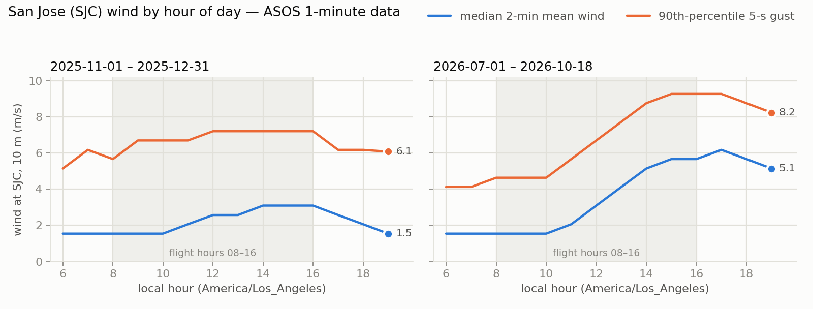
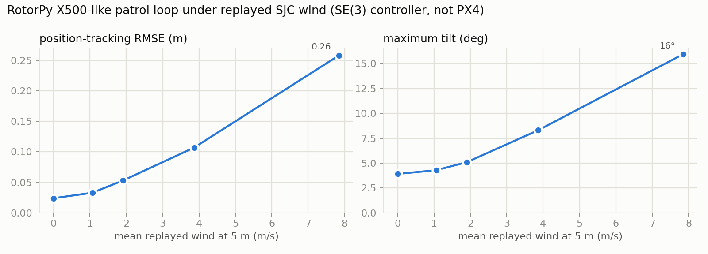

# Simulation + wind for DroneRanger: is the pipeline practical?

*Feasibility check and literature review. Hardware group, CS 7980 capstone, Northeastern University (Silicon Valley). Prepared 2026-10-19. Every number below comes from data pulled on that day or from a source in the reference list; numbers that are my own estimates say so.*

## Summary

**Question.** Can we fly a scripted PX4 mission in a simulator (Isaac Sim, as in last semester's legacy repo, or another one) while replaying *real* San Jose wind, so that the sim tells us something useful about real outdoor flights?

**Verdict: yes, it is practical, and most of it already runs.** Every stage was either run on a laptop today or checked against the source code of the tools involved:

| Stage | What | Status (2026-10-19) |
|---|---|---|
| 1. Wind data | NOAA ASOS 1-minute wind at San Jose airport (SJC), free via the Iowa Environmental Mesonet | **Run.** 218,107 one-minute records pulled (Jul 1 – Oct 18 2026, plus Nov–Dec 2025 as the seasonal match for O1/O2) |
| 2. Wind model | Move airport wind (10 m, open terrain) to garden height and roughness, then add Dryden turbulence | **Run and checked** against 1,200 measured 15-minute windows |
| 3. Inject into a simulator | Isaac Sim + Pegasus, Gazebo (gz) + PX4 SITL, PX4 SIH or RotorPy | **Verified in source code** for all four; **run** in RotorPy |
| 4. Scripted flight | MAVSDK-Python or ROS 2 offboard (both used last semester), or PX4 Mission mode | Legacy code exists; **run** with RotorPy's own controller |
| 5. Compare with reality | PX4 log: tracking error, tilt, EKF2 wind estimate vs. measured wind | Planned; every PX4 topic and parameter it needs was confirmed |

What this means for the plan:
- **Last semester's script-controlled flight** used **MAVSDK-Python** first, then **ROS 2 offboard over uXRCE-DDS** (`px4_msgs`). The separate Isaac repo runs **Isaac Sim 5.1 + Pegasus Simulator 5.1 + PX4 SITL v1.14.3** [[1]](#ref-1)–[[3]](#ref-3).
- **No simulator replays measured wind out of the box.** Each one needs a small adapter. In Pegasus it is a ~30-line custom drag class. In Gazebo it is a wind-message publisher plus one plugin line. RotorPy needed 10 lines, written and run today.
- **The recommended first platform is Gazebo (gz) + PX4 SITL.** It is what the hardware plan already uses for O0 rehearsal, it runs on the laptop, and it flies the same PX4 Mission mode used for O2. **Isaac Sim + Pegasus** is the second step, worth it when the camera matters too, but it needs a ≥ 16 GB RTX GPU (Explorer HPC or cloud). The laptop's RTX 4060 has 8 GB.
- **San Jose wind is strongly diurnal, and that is the main operational finding.** In Jul–Oct 2026, mornings (08–11) had a median 2-minute mean of 1.5 m/s. Afternoons (13–16) had 4.6 m/s, with 90th-percentile 5-second gusts of 8.7 m/s. In Nov–Dec 2025 the contrast was weaker, but storm days reached 11 m/s mean and 18 m/s gusts.
- **Standard turbulence models are too gentle for San Jose.** The MIL-F-8785C Dryden model needed its intensity raised by about ×1.5 (winter) to ×1.7 (summer–fall) to match measured SJC gustiness, even at the open airport. A garden among houses is gustier still.
- **The airport is not the garden.** Winter correlations between nearby stations were only r = 0.42–0.56. Gridded reanalysis read about 35 % lower than SJC. A cheap logging anemometer at the garden is needed to calibrate the transfer.

## 1. The legacy stack: what "script-controlled flight" meant last semester

| Period (Spring 2026) | Flight-control path | Simulator | Evidence |
|---|---|---|---|
| Weeks 2–8 | **MAVSDK-Python** offboard (`mavsdk.offboard`, `VelocityNedYaw`) on the Raspberry Pi over MAVLink | — | weekly reports, weeks 2 and 6 |
| Weeks 9–16 | **ROS 2 offboard** via **uXRCE-DDS** (`px4_msgs`: `OffboardControlMode`, `TrajectorySetpoint`, `VehicleCommand`) on the Jetson; flown outdoors in weeks 15–16 | Gazebo / Unity (legacy `DroneRanger` repo) | [[1]](#ref-1), [[4]](#ref-4) |
| March 2026 (separate repo) | PX4 shell (`commander takeoff`); no autonomy code yet | **Isaac Sim 5.1 + Pegasus 5.1 + PX4 SITL v1.14.3** (MAVLink HIL on TCP 4560), ROS 2 Jazzy camera topics | [[2]](#ref-2), [[3]](#ref-3) |

Any of the three can script a flight in simulation. For O2, the most realistic choice is **PX4 Mission mode**, uploaded from the same QGroundControl plan that will be flown in the garden. MAVSDK or ROS 2 then only arm the drone, upload the plan and log. The sim then exercises the exact PX4 code path used outdoors.

## 2. Wind data for San Jose

**What exists.** San Jose's open-data portal has no wind datasets (a catalogue search for "wind" returned 0 results). The usable public sources are:

| Source | What | Resolution | Access | Used here |
|---|---|---|---|---|
| NOAA ASOS 1-minute (NCEI TD-6405) via the Iowa Environmental Mesonet [[5]](#ref-5)–[[7]](#ref-7) | 2-minute average wind and the peak 5-second gust, every minute (hourly METAR omits most gusts) | 1 min, 1 kt | free CSV API; archive was current to 2026-10-18 | **yes, SJC (3.9 km from campus)** |
| ASOS/AWOS hourly METAR via IEM [[8]](#ref-8) | hourly mean wind, direction and gust (plus specials) | ~1 h, 1 kt | free CSV API | yes, for SJC, Reid-Hillview (RHV, 6.2 km), Moffett (NUQ), Palo Alto (PAO) |
| Open-Meteo historical API [[9]](#ref-9) | gridded reanalysis/analysis wind and gusts at any point | hourly, 9–25 km grid | free, no key | yes, at the campus |
| CIMIS agricultural stations [[10]](#ref-10) | hourly wind at 2 m (close to flight height) | hourly | free key | **no.** The San Jose station (#69) closed in 2002; the nearest active ones are 25–40 km away |
| Logging anemometer at the garden | the wind the drone actually meets | 1 s | buy (~tens of dollars) | **recommended** |

The download is scripted: `python wind/tools/fetch_wind.py --start 2026-07-01 --end 2026-10-18`. Raw CSVs go to the git-ignored `reference/08_wind_simulation/data/`.

**What the last few months looked like** (SJC, 10 m anemometer, flight hours 08–16 local; full tables in [data/sj_wind_summary.md](data/sj_wind_summary.md)):

| SJC 1-minute data | Jul 1 – Oct 18, 2026 | Nov 1 – Dec 31, 2025 |
|---|---|---|
| Coverage | 87 % of minutes | 92 % of minutes |
| Median 2-min mean wind, morning 08–11 / afternoon 13–16 | 1.5 / 4.6 m/s | 1.5 / 3.1 m/s |
| 90th-percentile 5-s gust, morning / afternoon | 4.6 / 8.7 m/s | 6.2 / 7.2 m/s |
| Share of minutes with mean ≤ 5 m/s, morning / afternoon | 97 % / 52 % | 89 % / 82 % |
| Share of minutes with gust ≤ 8 m/s, morning / afternoon | 99 % / 81 % | 95 % / 94 % |
| Highest 5-s gust in flight hours | 15.9 m/s | 18.0 m/s (morning of a storm day) |
| Gust factor (5-s gust ÷ 2-min mean), median | 1.36 | 1.29 |
| Afternoon direction (mean ≥ 2 m/s) | NW 83 % | NW 55 % |

Two points matter for flight planning:
- In late summer and fall the afternoon northwest sea breeze dominates, so **morning slots are much calmer**. This confirms the earlier daily-data finding in `reference/07_california_silicon_valley/NOTES.md`.
- In November–December the average day is calmer but **storm days are windier**. The windiest 15-minute flight-hour window was 11.0 m/s mean with 16.5 m/s gusts (2025-11-13, 09:15). A go/no-go check on the day matters more than the season.

**How well does one station represent another place?** All comparisons below are hourly, during flight hours:

| SJC vs. | Jul–Oct 2026: r, speed ratio | Nov–Dec 2025: r, speed ratio |
|---|---|---|
| Reid-Hillview (RHV, 6 km, east San Jose) | 0.81, 0.82 | 0.56, 0.70 |
| Moffett (NUQ, 16 km) | 0.77, 1.20 | 0.42, 0.93 |
| Palo Alto (PAO, 24 km) | 0.76, 1.27 | 0.46, 1.05 |
| Open-Meteo grid point at the campus | 0.77, 0.63 | 0.49, 0.65 |

In the sea-breeze season the region moves together (r ≈ 0.8). In light winter winds, local effects dominate (r ≈ 0.4–0.6). The gridded model reads about a third lower than SJC, so model data can stand in for a station only after bias correction.

## 3. From airport wind to garden wind

`wind/tools/make_wind_profile.py` turns a chosen historical window into a time series the simulator replays (50 Hz, ENU, m/s):

1. **Mean wind.** It takes the SJC 1-minute vector series and interpolates it, so minute-scale lulls and gusts happen at their real times.
2. **Height and roughness transfer.** A log-law profile carries the airport wind (10 m, roughness length z₀ = 0.03 m) up to a 60 m blending height and back down over the rougher garden. This is the standard roughness-dependent method [[11]](#ref-11). For 5 m altitude and a suburban z₀ = 0.5 m, the factor is **0.63**.
   - This is only a first-order estimate. Among houses, 3–10 m lies inside the roughness sublayer, where the log law is unreliable [[12]](#ref-12).
   - One measured garden/SJC ratio replaces it (`--height-factor`). The ratio can come from an on-site anemometer or from the drone's own wind estimate (Section 6.4).
3. **Turbulence.** Dryden spectra in the MIL-F-8785C low-altitude form [[13]](#ref-13), [[14]](#ref-14), scaled from the wind at 20 ft. Eddies are advected past the hovering drone at the mean wind speed, following Taylor's frozen-turbulence hypothesis [[15]](#ref-15). `--turb data` rescales the intensity so the synthetic per-minute 5-s gust factor matches the measured one in that window.

**Check against measurement.** `wind/tools/validate_turbulence.py` compares like with like: it simulates the anemometer itself (10 m, open terrain) for 1,200 random 15-minute flight-hour windows with mean ≥ 2 m/s, and compares the synthetic and measured gust factors:

| Period | Measured gust factor (median) | MIL-F-8785C synthetic | Turbulence scale needed: median (IQR) |
|---|---|---|---|
| Nov–Dec 2025 (600 windows) | 1.31 | 1.21 | **×1.48** (1.19–1.83) |
| Jul–Oct 2026 (600 windows) | 1.38 | 1.22 | **×1.72** (1.37–2.14) |
| by mean wind: 2–4 / 4–6 / ≥ 6 m/s | 1.38 / 1.31 / 1.29 | 1.20 / 1.22 / 1.22 | ×1.82 / ×1.40 / ×1.27 |

So textbook "light turbulence" understates San Jose gustiness even at the airport. Part of the excess in light wind comes from the 1-kt reporting resolution: 4 kt gusting 5 kt already reads as a gust factor of 1.25. A garden among houses at 5 m will be gustier than the airport. Neutral surface-layer scaling suggests turbulence intensity about 2.5 times higher (my estimate, from σᵤ ∝ 1/ln(z/z₀); the tool reports it as `surface_layer_TI_estimate`). In practice, sweep `--ti-scale` over 1.5–3 until on-site measurements narrow it.

## 4. Injecting wind into the simulators

All of the following was verified in source code at named tags (details and saved files in `reference/08_wind_simulation/NOTES.md`).

| Simulator | Built-in wind | How to replay a measured time series | PX4 | Runs on our laptop? |
|---|---|---|---|---|
| **Isaac Sim 5.1 + Pegasus 5.1** [[3]](#ref-3), [[16]](#ref-16) | **None.** `LinearDrag` uses ground-relative body velocity. The PX4 backend's airspeed line says `# TODO - add wind here` | Subclass `Drag` with v_air = v − w(t) (~30 lines), set `MultirotorConfig.drag`. Or apply a force in a physics callback, as in the open Pegasus issue on wind [[17]](#ref-17). Standalone scripts with lockstep PX4 make replay deterministic | pinned to **v1.14.3** | **No** (needs RTX ≥ 16 GB); Explorer HPC L40/L40S/A6000 or cloud |
| **Gazebo (gz Harmonic) + PX4 SITL** [[18]](#ref-18), [[19]](#ref-19) | `windy` world (5, 2, 0 m/s) [[20]](#ref-20). In PX4 v1.17 wind reaches the stock x500 only through **rotor drag** in the motor model [[21]](#ref-21) (my estimate: ~1.3 N, a ~4° lean, at 5.4 m/s). PX4 `main` loads the WindEffects system since July 2026 [[22]](#ref-22) | Publish `gz.msgs.Wind` on `/world/<world>/wind` at ≤ physics rate. Add `<enable_wind>` on the x500 base link (an open PR does this [[23]](#ref-23)) and set `time_for_rise` ≈ physics step. Better still, compute drag ourselves and apply it on `/world/<world>/wrench/persistent` (ApplyLinkWrench, already loaded in v1.17). WindEffects' force law is mass × gain × (v_wind − v_link): about 2 N per m/s on the x500 at default gain, so it needs calibrating | v1.17 stable; **same model family as our X500** | **Yes** (Linux, WSL2 or Docker) |
| **PX4 SIH** [[24]](#ref-24) | `SIH_WIND_N/E` parameters, changeable in flight; first-order drag (`SIH_KDV`); no vertical wind | Stream `PARAM_SET` from MAVSDK, or a small C++ patch to read a series | **main / v1.18-rc1 only**; not in v1.17.0 | Yes, headless and fastest |
| **RotorPy** [[25]](#ref-25), [[26]](#ref-26) | Constant, sinusoid, Dryden, spatial "wind tunnel"; **air-relative** parasitic and rotor drag | `update(t, position)` class reading our CSV (**done**, 10 lines) | Optional HIL bridge (TCP 4560), but it sends no HIL_GPS, so Mission mode is unverified | **Yes**, pure Python |
| OmniDrones / Aerial Gym [[27]](#ref-27), [[28]](#ref-28) | Random sinusoidal force (OmniDrones Track task) / random disturbance (Aerial Gym); not air-relative | Possible, but they are RL training environments | no | No (Isaac) |
| AirSim [[29]](#ref-29) | `simSetWind` (NED) | — | yes | archive announced; not recommended |

Two older options were rejected:
- **Gazebo Classic** has a mean + noise + one-gust wind plugin with no file input [[30]](#ref-30), derived from RotorS [[31]](#ref-31). Gazebo Classic reached end of life on 2025-01-31 [[32]](#ref-32).
- The only open tool found that loads measured wind into PX4 SITL is a Gazebo Classic plugin for a **static** CFD wind field [[33]](#ref-33). **No public project replays measured wind time series into PX4 SITL or Isaac/Pegasus.** That gap makes this a reasonable small research contribution.

**Comparing sim with reality needs only standard PX4 features:**
- EKF2 can estimate wind on a multirotor from drag (`EKF2_DRAG_CTRL`, tuned with `EKF2_BCOEF_X/Y` and `EKF2_MCOEF`) and logs it in the `wind` topic [[34]](#ref-34). That gives a sim-to-sim check (estimated vs. injected) and a real-flight wind record to replay afterwards.
- Wind failsafes exist: `COM_WIND_WARN` (v1.13+), `COM_WIND_MAX` (v1.14+) and `COM_WIND_MAX_ACT` (v1.15+). All are disabled by default [[35]](#ref-35). The Pegasus stack's v1.14.3 has no `COM_WIND_MAX_ACT` and no `/fmu/out/wind` over DDS, although the wind estimate is still in the log.

## 5. End-to-end check on a laptop

To show that stages 1–4 connect, `wind/tools/rotorpy_wind_demo.py` flies an X500-like quadrotor in RotorPy. It flies three loops of an 8 m × 8 m garden square at 5 m altitude and 1 m/s, while replaying four real SJC windows produced by `make_wind_profile.py` (`--turb data`, or MIL × 1.5 when the window was too calm to calibrate).

The model uses the mass, inertia, motor constant and rotor-drag coefficient from PX4's own Gazebo x500. Mass is raised to 2.1 kg for the Jetson payload, and body drag is assumed. The controller is RotorPy's SE(3) controller with perfect state feedback, **not PX4**, so treat the numbers as a pipeline check, not an X500 prediction.

| Replayed window (SJC 10 m mean) | Wind at 5 m, mean / max | Tracking RMSE | Max error | Max tilt |
|---|---|---|---|---|
| no wind | 0 | 0.02 m | 0.04 m | 3.9° |
| 2025-11-30 09:15, median morning (1.5 m/s) | 1.1 / 1.5 m/s | 0.03 m | 0.06 m | 4.3° |
| 2025-12-05 13:15, median afternoon (2.9 m/s) | 1.9 / 3.2 m/s | 0.05 m | 0.11 m | 5.1° |
| 2025-11-07 15:30, 90th-percentile afternoon (5.6 m/s) | 3.9 / 5.1 m/s | 0.11 m | 0.19 m | 8.3° |
| 2025-11-13 09:15, windiest morning (11.0 m/s) | 7.9 / 11.1 m/s | 0.26 m | 0.37 m | 16.0° |

The chain works: error and tilt grow with the replayed wind, and no rotor saturated. A full 98-second flight took about one minute of CPU time. In PX4 the steady part of the error will be smaller, because the velocity loop has an integrator and SE(3) here does not. Gusts will still show.

Real flights will add something no simulator here models well: **estimation error** (GNSS without RTK, and barometer error from dynamic pressure in wind). That is why the comparison against real logs in stage 5 matters.

## 6. What the literature says about wind and small multirotors

The search covered seven themes. It added 51 peer-reviewed or primary sources to those already in the sim2real list, each verified as described in [references.md](references.md). The short version is below; the per-paper notes are in the reference list.

### 6.1 Wind and turbulence models

**The standard tool.** The workhorse is the Dryden/von Kármán spectral model in its military low-altitude form, valid from 10 ft to 1,000 ft [[13]](#ref-13), [[36]](#ref-36):
- Vertical gust intensity is 0.1 × the mean wind at 20 ft.
- Horizontal intensity and scale length grow with height through (0.177 + 0.000823h).
- The mean wind follows a log profile [[14]](#ref-14), [[37]](#ref-37).

At 3–10 m this gives horizontal gusts of about 0.2 × the 20-ft wind, with scale lengths of roughly 20–70 m. Gust time series are made by shaping white noise with discrete filters [[38]](#ref-38). A multirotor-specific review also provides Python Dryden code [[14]](#ref-14).

**Two limits matter here:**
- These models assume homogeneous, Gaussian turbulence at a single point.
- Measurements 4 m above ground show that small vehicles feel strong roll inputs from vertical gusts that vary across their own span, which a single uniform wind vector under-represents [[39]](#ref-39).

Our own check (Section 3) adds a third limit: at San Jose airport the MIL intensity is about 1.5–1.7 times too low.

### 6.2 Low-altitude wind among houses and trees: why the airport is not the garden

**Built-up areas break the standard profile.** Over cities, a *roughness sublayer* reaches about 2.5–3 times the building height. Inside it, log-law scaling is unreliable [[12]](#ref-12). With one- and two-storey houses, the whole 3–10 m patrol band lies inside that layer. Within and just above tree canopies, flow is dominated by large coherent sweeps and behaves like a mixing layer [[40]](#ref-40). The roughness length and displacement height needed for any height correction can be estimated from building and tree geometry [[41]](#ref-41) and terrain type [[11]](#ref-11), [[42]](#ref-42).

**Building effects are sharp and local:**
- Along a large-eddy-simulated flight path over a suburban building, in a 3 m/s reference wind, crossing the roof shear layer at 5 m/s changed the relative flow angle by about 20° and airspeed by about 50 % within 0.25 s [[43]](#ref-43).
- In an 8 kt wind, building wakes caused attitude excursions of up to 10° on a small unmanned helicopter [[44]](#ref-44).
- Urban wind is named as a key inhibitor of urban drone use [[45]](#ref-45).

**The workable designs** treat the station wind as the *above-roof boundary condition* of a local flow model:
- CFD driven by the prevailing wind [[46]](#ref-46);
- a precomputed large-eddy-simulation database per site [[47]](#ref-47);
- a learned local flow field from onboard range data [[48]](#ref-48);
- a station-to-CFD transfer that matched station records within 12 % in speed and 8 % in bearing [[49]](#ref-49).

### 6.3 How multirotors respond to wind

**Drag depends on airspeed, not ground speed.** Rotor drag from blade flapping and induced drag is roughly linear in *air-relative* velocity [[50]](#ref-50), [[51]](#ref-51). A simulator must therefore compute drag from v − w, which RotorPy does and Pegasus's `LinearDrag` does not. Drag-aware feed-forward halves tracking error [[52]](#ref-52). A blade-element model with a learned residual is the next step up in fidelity [[53]](#ref-53).

**Measured magnitudes:**
- In NASA wind-tunnel tests of five commercial multicopters at about 6–24 m/s, a 1.5 kg 3DR Solo had about 0.8 lb (3.6 N) of mean drag at about 12 m/s [[54]](#ref-54).
- A wind-tunnel-based model predicted the station-keeping error spread within 7 % *along* the wind but only within 56 % *across* it [[55]](#ref-55). Simple sims get the mean response right and the cross-wind turbulence response poorly. That is a metric worth reporting in our sim-vs-real comparison.
- Power depends on airspeed, so holding position into a headwind costs endurance. A validated range/endurance model quantifies this [[56]](#ref-56).
- A public dataset of 209 outdoor quadrotor flights with an onboard anemometer can test drag and power models before we have X500 logs [[57]](#ref-57).
- Ground effect matters only near take-off and landing, and must be separated from wind in low-altitude logs [[58]](#ref-58).

### 6.4 The drone as its own anemometer

A hovering multirotor's tilt and drag reveal the wind it feels. The inertial-only idea [[59]](#ref-59) has since been validated against reference anemometers:

| Study | Speed error | Direction error | Setting |
|---|---|---|---|
| Palomaki et al. [[60]](#ref-60) | < 0.5 m/s | < 30° | 10 m, beside sonic anemometers |
| Simma et al. [[61]](#ref-61) | 0.26–0.29 m/s RMSE | 4–5° | autopilot logs only, 0–5 m/s wind |
| Wetz et al. [[62]](#ref-62) | < 0.3 m/s RMS | < 8° | 76 flights against a 99 m tower |
| Crowe et al. [[63]](#ref-63) | 0.61 m/s RMSE (LSTM) | — | learned from attitude data |

Other approaches:
- Richer motion models raise the estimation bandwidth [[64]](#ref-64).
- Telemetry-only drag calibration plus a Kalman filter runs onboard [[65]](#ref-65).
- Propeller power and speed (ESC data) can separate aerodynamic from contact forces [[66]](#ref-66).

**What this means for DroneRanger.** PX4 already implements drag fusion in EKF2 [[34]](#ref-34). X500 hover segments in the garden should therefore give the wind the drone actually felt, to about 0.3–0.5 m/s. That gives the garden-to-SJC ratio needed in Section 3 without extra hardware. An anemometer remains the independent check. The statistics for comparing SITL and real PX4 logs are worked out in a recent PX4 testbed study [[67]](#ref-67).

### 6.5 Controllers that cope with wind

**Robust inner loops reject wind without an exact wind model:**
- Incremental nonlinear dynamic inversion (INDI) [[68]](#ref-68) beat PID when flying in and out of a 10 m/s wind-tunnel jet [[69]](#ref-69).
- INDI with flatness feed-forward tracked at up to 12.9 m/s with 6.6 cm RMS error and no aerodynamic model [[70]](#ref-70).
- Adding INDI and drag modelling cut tracking error by more than 78 % for both NMPC and flatness-based control [[71]](#ref-71).
- L1-adaptive NMPC cut error by more than 90 % under fan wind and unknown payloads [[72]](#ref-72).
- An L1-augmented geometric controller is a natural adaptive baseline [[73]](#ref-73).
- Measured onboard wind can be fed straight into geometric control [[74]](#ref-74).

**Learning-based results:**
- Neural-Fly learned a wind representation and flew in a fan-array tunnel at up to 12.1 m/s [[75]](#ref-75), building on learned-residual aerodynamics [[76]](#ref-76).
- Meta-learning adaptive features in closed-loop simulation shows how a wind-randomised simulator can *train* adaptation [[77]](#ref-77).
- RL policies trained with random force disturbances transfer to real fan wind:
  - DATT: 34 % less error than adaptive NMPC [[78]](#ref-78);
  - the domain-randomised low-level policies of Molchanov et al. [[79]](#ref-79);
  - an extreme-adaptation controller [[80]](#ref-80);
  - a recent DRL-INDI preprint: 94.6 % vs 36.0 % success in ≤ 3.5 m/s gusts [[81]](#ref-81).

**What this means for us.** Nearly all of this testing uses fans or wind tunnels at ≤ 12 m/s, not real atmospheric turbulence. To test robustness, a correct mean force plus plausible random disturbances is enough. The measured-wind replay is what lets us predict *a specific* outdoor flight. That makes it the new part of this work.

### 6.6 Wind in simulators: what others built

**Off-the-shelf support is basic** (Section 4 and [[82]](#ref-82)). RotorPy has the most complete built-in wind: Dryden, sinusoid and spatial profiles, with air-relative aerodynamics [[25]](#ref-25).

**Closest existing work:**
- The nearest pipeline to ours is OpenStreetMap buildings → OpenFOAM CFD → a Gazebo plugin → PX4 SITL. It uses a *steady* CFD field, not measured time series [[83]](#ref-83).
- A Gazebo weather-plugin case study measured wind effects on a PX4 UAV with synthetic wind [[84]](#ref-84).
- A CNN trained on CFD predicts 3D wind from sparse measurements. It works best well above the ground (> 50 m), unlike our band [[85]](#ref-85).

**Validating against controllable wind** can use fan arrays:
- Caltech's Real Weather Wind Tunnel, used by Neural-Fly [[75]](#ref-75);
- an open-source low-cost multi-fan system giving 0.5–3.4 m/s steady wind and 0.125–0.5 Hz gusts, for small vehicles only [[86]](#ref-86).

### 6.7 Wind as an operational limit

- **Data semantics matter.** An hourly METAR wind is a 2-minute average at report time. A METAR gust is reported only when the peak exceeds the 10-minute lull by ≥ 10 kt, so most light-wind hours carry no gust. The 1-minute archive used here gives the peak 5-s gust of every minute [[7]](#ref-7).
- **Flyability.** Using hourly reanalysis wind at 100 m against manufacturer limits (median 10 m/s for common drones), global median flyability is 5.7 h/day, or 2.0 h/day in daylight [[87]](#ref-87). Their 100 m wind overstates 3–10 m wind. Section 2 applies the same idea to SJC 1-minute data.
- **Go/no-go needs fine-scale data.** A weather-risk model for small drones argues that forecasts finer than 1 km are needed [[88]](#ref-88). An airport value is a starting point, not a backyard decision.
- **For DroneRanger** (my inference from the above, not a published limit): the physical envelope of a ~2 kg quadrotor is roughly 8–10 m/s mean wind. The first O1/O2 flights should keep a much lower operating limit, for example SJC mean ≤ 5 m/s and gust ≤ 8 m/s. Both limits together were met in 89 % (Nov–Dec 2025) and 97 % (Jul–Oct 2026) of morning minutes, but in only 52 % of Jul–Oct afternoon minutes. The SITL runs in Section 7 should refine it.

### 6.8 How much wind fidelity does the simulator need?

| Level | What is replayed | Good for | Evidence |
|---|---|---|---|
| 0 | Measured mean wind (1-min SJC × height factor) | along-wind offset, tilt, battery cost, failsafe logic | [[55]](#ref-55), [[56]](#ref-56) |
| 1 | + Dryden turbulence, intensity calibrated to measured gusts, drag from airspeed | gust response, controller robustness | Section 3; [[13]](#ref-13), [[52]](#ref-52), [[78]](#ref-78) |
| 2 | + spatial field around the house (CFD/LES/learned) | cross-wind errors and wakes near buildings and trees | [[43]](#ref-43), [[47]](#ref-47), [[83]](#ref-83) |
| 3 | The wind EKF2 estimated in the real flight, replayed in SITL | like-for-like sim-vs-real comparison | [[34]](#ref-34), [[61]](#ref-61), [[62]](#ref-62) |

Levels 0–1 are what this report builds. Level 3 comes free once real flights log `EKF2_DRAG_CTRL` wind. Level 2 is worth doing only if the cross-wind errors between sim and real demand it.

## 7. Recommended plan (fits the hardware scope and the O1/O2 dates)

This is an extension of the planned **O0 SITL rehearsal** and of the **weather gate**, not new algorithm work. It stays inside the hardware group's scope.

| When | Step | Output |
|---|---|---|
| Week of 10/19 | Bring up PX4 SITL + gz x500 (Docker or a Linux machine). Add a ~50-line gz-transport node that replays `make_wind_profile.py` CSVs. Calibrate the wind force against RotorPy's air-relative drag. Enable `EKF2_DRAG_CTRL` in SITL and check that the estimated wind converges to the injected wind | wind-replay node + SITL config in the repo |
| Week of 10/26 | Fly the **O2 Mission plan** in SITL under the four SJC scenarios, plus a `--ti-scale` sweep of 1.5–3. Record tracking error, tilt, battery draw and failsafe behaviour. Propose a go/no-go wind limit and the `COM_WIND_WARN` / `COM_WIND_MAX` values (the action parameter needs PX4 ≥ v1.15 on the Pixhawk) | wind limit for the flight checklist |
| O1 (early Nov) | Log a garden anemometer at about 2–5 m during flights. Pull SJC 1-minute data for the same minutes. Fit the garden/SJC height factor and turbulence scale | calibrated `--height-factor`, `--ti-scale` |
| O2 (mid–late Nov) | Replay each real flight's wind in SITL and compare the distributions of tracking and altitude error, sim vs. real (a *sim-to-real predictivity* check [[89]](#ref-89)) | the sim-vs-real comparison table for the final report |
| Optional (with the algorithm group) | Port the same wind series into Isaac Sim + Pegasus with a `WindDrag` class on Explorer HPC, so camera-based work also sees wind | shared wind module |

## 8. Risks and open questions

- **GPU.** Isaac Sim needs an RTX GPU with ≥ 16 GB. The laptop has 8 GB. Explorer HPC's L40/L40S/A6000 nodes qualify but run without a local display. The legacy README also reports an Isaac Sim 5.1 release-candidate bug in standalone (scripted) mode. Re-test it on 5.1.0 final.
- **PX4 version skew.** Pegasus is pinned to PX4 v1.14.3. Gazebo wind is easiest on PX4 `main`. SIH wind needs v1.18. The Pixhawk's PX4 version should be checked, and the sim kept on the same version where possible.
- **Wind-force fidelity.** Gazebo's WindEffects is a mass-proportional linear law. Pegasus has only linear drag. Neither models rotor drag versus airspeed the way the literature does (Section 6). Prefer computing drag ourselves and applying a force.
- **Airport to garden.** The transfer factor and turbulence scale are estimates until on-site data exist. In light winter winds even stations 6 km apart disagree.
- **What sims leave out.** Building wakes, downwash, ground effect near take-off and landing, and sensor errors caused by wind. These need CFD or real data (Section 6).
- **Data latency.** The 1-minute archive is about a day behind. A live go/no-go check should use the current METAR or the on-site anemometer.

## 9. Files

| Path | What |
|---|---|
| `wind/tools/fetch_wind.py` | Downloads SJC 1-minute data, METAR for SJC/RHV/NUQ/PAO, and Open-Meteo |
| `wind/tools/wind_stats.py` | Flight-hour statistics → `wind/data/sj_wind_summary.md`, `sjc_1min_diurnal.csv` |
| `wind/tools/make_wind_profile.py` | Measured wind → replayable 50 Hz time series (+ JSON metadata) |
| `wind/tools/validate_turbulence.py` | Dryden/MIL turbulence vs. measured gusts → `wind/data/turbulence_validation.csv` |
| `wind/tools/rotorpy_wind_demo.py` | End-to-end replay in RotorPy → `wind/data/rotorpy_demo_results.csv` |
| `wind/tools/make_figures.py` | Figures in `wind/figures/` |
| `reference/08_wind_simulation/` | Local-only: raw data, generated profiles, saved docs and source files, open-access papers, `NOTES.md` |

## References

*IEEE style, numbered in order of first citation. Journal articles were resolved through LibKey (Northeastern University Library); conference papers, chapters, books and reports were checked against Crossref or the publisher, preprints on arXiv. Access links, themes and BibTeX are in [references.md](references.md) and [references.bib](references.bib).*

[1] R. Yin, “Drone project technical handover: PX4 / ROS 2 / OAK-D Lite autonomous flight and obstacle-aware planning system,” NEURAI Lab, Northeastern Univ., San Jose, CA, USA, Internal tech. rep., 2026.  
[2] RipZou, “DroneRangerIssac,” GitHub repository, commit 5acbe7b, Mar. 2026. [Online]. Available: https://github.com/RipZou/DroneRangerIssac  
[3] M. Jacinto *et al.*, “Pegasus Simulator: An Isaac Sim framework for multiple aerial vehicles simulation,” in *Proc. Int. Conf. Unmanned Aircraft Syst. (ICUAS)*, 2024, pp. 917–922, doi: 10.1109/ICUAS60882.2024.10556959.  
[4] Z. Ling *et al.*, “DroneRanger: Simulation-guided UAV framework for autonomous wildlife deterrence,” in *Proc. IEEE 16th Annu. Comput. Commun. Workshop Conf. (CCWC)*, 2026, pp. 1221–1227, doi: 10.1109/CCWC67433.2026.11393823.  
[5] Iowa Environmental Mesonet, “ASOS one minute data download,” *Iowa State University*. Accessed: Oct. 19, 2026. [Online]. Available: https://mesonet.agron.iastate.edu/request/asos/1min.phtml  
[6] NOAA National Centers for Environmental Information, “ASOS surface 1-minute, page 1 data (TD-6405) format documentation,” *NCEI data archive*. Accessed: Oct. 19, 2026. [Online]. Available: https://www.ncei.noaa.gov/pub/data/asos-onemin/td6405.txt  
[7] National Oceanic and Atmospheric Administration, Department of Defense, Federal Aviation Administration, and United States Navy, “Automated Surface Observing System (ASOS) user's guide,” National Oceanic and Atmospheric Administration, User guide, Mar. 1998. [Online]. Available: https://www.weather.gov/media/asos/aum-toc.pdf  
[8] Iowa Environmental Mesonet, “ASOS-AWOS-METAR data download,” *Iowa State University*. Accessed: Oct. 19, 2026. [Online]. Available: https://mesonet.agron.iastate.edu/request/download.phtml  
[9] Open-Meteo, “Historical weather API,” *Open-Meteo documentation*. Accessed: Oct. 19, 2026. [Online]. Available: https://open-meteo.com/en/docs/historical-weather-api  
[10] California Department of Water Resources, “CIMIS station list (web API),” *California Irrigation Management Information System*. Accessed: Oct. 19, 2026. [Online]. Available: https://et.water.ca.gov/api/station  
[11] J. Wieringa, “Roughness-dependent geographical interpolation of surface wind speed averages,” *Q. J. R. Meteorol. Soc.*, vol. 112, no. 473, pp. 867–889, Jul. 1986, doi: 10.1002/qj.49711247316.  
[12] M. Roth, “Review of atmospheric turbulence over cities,” *Q. J. R. Meteorol. Soc.*, vol. 126, no. 564, pp. 941–990, Apr. 2000, doi: 10.1002/qj.49712656409.  
[13] U.S. Department of Defense, “Military specification: Flying qualities of piloted airplanes,” U.S. Department of Defense, Washington, DC, USA, Military specification MIL-F-8785C, Nov. 1980.  
[14] P. Abichandani, D. Lobo, G. Ford, D. Bucci, and M. Kam, “Wind measurement and simulation techniques in multi-rotor small unmanned aerial vehicles,” *IEEE Access*, vol. 8, pp. 54910–54927, Mar. 2020, doi: 10.1109/ACCESS.2020.2977693.  
[15] G. I. Taylor, “The spectrum of turbulence,” *Proc. R. Soc. Lond. A*, vol. 164, no. 919, pp. 476–490, Feb. 1938, doi: 10.1098/rspa.1938.0032.  
[16] PegasusSimulator, “Pegasus Simulator,” GitHub repository, tag v5.1.0, Oct. 2025. [Online]. Available: https://github.com/PegasusSimulator/PegasusSimulator  
[17] BerkeCanGoktas, “How to add wind in headless scripts? (issue #132),” *PegasusSimulator GitHub issues*. Accessed: Oct. 19, 2026. [Online]. Available: https://github.com/PegasusSimulator/PegasusSimulator/issues/132  
[18] PX4 Autopilot, “Gazebo simulation,” *PX4 User Guide (main)*. Accessed: Sep. 27, 2026. [Online]. Available: https://docs.px4.io/main/en/sim_gazebo_gz/  
[19] Open Robotics, “WindEffects system (source),” *gz-sim repository, branch gz-sim8*. Accessed: Oct. 19, 2026. [Online]. Available: https://github.com/gazebosim/gz-sim/blob/gz-sim8/src/systems/wind_effects/WindEffects.cc  
[20] PX4 Autopilot, “windy.sdf world,” *PX4-gazebo-models repository (main)*. Accessed: Oct. 19, 2026. [Online]. Available: https://github.com/PX4/PX4-gazebo-models/blob/main/worlds/windy.sdf  
[21] Open Robotics, “MulticopterMotorModel system (source),” *gz-sim repository, branch gz-sim8*. Accessed: Oct. 19, 2026. [Online]. Available: https://github.com/gazebosim/gz-sim/blob/gz-sim8/src/systems/multicopter_motor_model/MulticopterMotorModel.cc  
[22] PX4 Autopilot, “fix(simulation): make wind affect the airspeed sensor in gz (pull request #28042),” *PX4-Autopilot GitHub, merged 2026-07-22*. Accessed: Oct. 19, 2026. [Online]. Available: https://github.com/PX4/PX4-Autopilot/pull/28042  
[23] PX4 Autopilot, “feat: add real wind effect on multicopter-like models with WindEffects gz plugin (pull request #130),” *PX4-gazebo-models GitHub, open*. Accessed: Oct. 19, 2026. [Online]. Available: https://github.com/PX4/PX4-gazebo-models/pull/130  
[24] PX4 Autopilot, “Simulation-in-hardware (SIH),” *PX4 User Guide (main)*. Accessed: Oct. 19, 2026. [Online]. Available: https://docs.px4.io/main/en/sim_sih/  
[25] S. Folk, J. Paulos, and V. Kumar, “RotorPy: A Python-based multirotor simulator with aerodynamics for education and research,” Jun. 2023, arXiv:2306.04485.  
[26] spencerfolk, “RotorPy,” GitHub repository, PyPI release 3.0.0, Sep. 2026. [Online]. Available: https://github.com/spencerfolk/rotorpy  
[27] B. Xu, F. Gao, C. Yu, R. Zhang, Y. Wu, and Y. Wang, “OmniDrones: An efficient and flexible platform for reinforcement learning in drone control,” *IEEE Robot. Autom. Lett.*, vol. 9, no. 3, pp. 2838–2844, Mar. 2024, doi: 10.1109/LRA.2024.3356168.  
[28] M. Kulkarni, W. Rehberg, and K. Alexis, “Aerial Gym Simulator: A framework for highly parallelized simulation of aerial robots,” *IEEE Robot. Autom. Lett.*, vol. 10, no. 4, pp. 4093–4100, Apr. 2025, doi: 10.1109/LRA.2025.3548507.  
[29] S. Shah, D. Dey, C. Lovett, and A. Kapoor, “AirSim: High-fidelity visual and physical simulation for autonomous vehicles,” in *Field and Service Robotics*, ser. Springer Proceedings in Advanced Robotics, vol. 5. Cham, Switzerland: Springer, 2018, pp. 621–635, doi: 10.1007/978-3-319-67361-5_40.  
[30] PX4 Autopilot, “gazebo_wind_plugin.cpp,” *PX4-SITL_gazebo-classic repository (main)*. Accessed: Oct. 19, 2026. [Online]. Available: https://github.com/PX4/PX4-SITL_gazebo-classic/blob/main/src/gazebo_wind_plugin.cpp  
[31] F. Furrer, M. Burri, M. Achtelik, and R. Siegwart, “RotorS—A modular Gazebo MAV simulator framework,” in *Robot Operating System (ROS): The Complete Reference (Volume 1)*, A. Koubaa, Ed., ser. Studies in Computational Intelligence, vol. 625. Cham, Switzerland: Springer, 2016, pp. 595–625, doi: 10.1007/978-3-319-26054-9_23.  
[32] Open Robotics, “Gazebo Classic and Citadel end of life,” *Open Robotics Discourse*. Accessed: Oct. 19, 2026. [Online]. Available: https://discourse.openrobotics.org/t/gazebo-classic-and-citadel-end-of-life/48152  
[33] charlotte-visionlab, “px4_gazebo_wind3d,” GitHub repository, 2025. [Online]. Available: https://github.com/charlotte-visionlab/px4_gazebo_wind3d  
[34] PX4 Autopilot, “Using PX4's navigation filter (EKF2),” *PX4 User Guide (v1.17)*. Accessed: Sep. 27, 2026. [Online]. Available: https://docs.px4.io/v1.17/en/advanced_config/tuning_the_ecl_ekf.html  
[35] PX4 Autopilot, “Commander parameters (commander_params.c),” *PX4-Autopilot repository, tag v1.17.0*. Accessed: Oct. 19, 2026. [Online]. Available: https://github.com/PX4/PX4-Autopilot/blob/v1.17.0/src/modules/commander/commander_params.c  
[36] U.S. Department of Defense, “Department of Defense handbook: Flying qualities of piloted aircraft,” U.S. Department of Defense, Washington, DC, USA, Military handbook MIL-HDBK-1797, Dec. 1997.  
[37] R. B. Stull, *An Introduction to Boundary Layer Meteorology*. Dordrecht, The Netherlands: Springer, 1988, doi: 10.1007/978-94-009-3027-8.  
[38] T. R. Beal, “Digital simulation of atmospheric turbulence for Dryden and von Karman models,” *J. Guid. Control Dyn.*, vol. 16, no. 1, pp. 132–138, Jan. 1993, doi: 10.2514/3.11437.  
[39] S. Watkins, J. Milbank, B. J. Loxton, and W. H. Melbourne, “Atmospheric winds and their implications for microair vehicles,” *AIAA J.*, vol. 44, no. 11, pp. 2591–2600, Nov. 2006, doi: 10.2514/1.22670.  
[40] J. Finnigan, “Turbulence in plant canopies,” *Annu. Rev. Fluid Mech.*, vol. 32, pp. 519–571, 2000, doi: 10.1146/annurev.fluid.32.1.519.  
[41] C. S. B. Grimmond and T. R. Oke, “Aerodynamic properties of urban areas derived from analysis of surface form,” *J. Appl. Meteorol.*, vol. 38, no. 9, pp. 1262–1292, Sep. 1999, doi: 10.1175/1520-0450(1999)038<1262:APOUAD>2.0.CO;2.  
[42] J. Wieringa, “Representative roughness parameters for homogeneous terrain,” *Boundary-Layer Meteorol.*, vol. 63, no. 4, pp. 323–363, Mar. 1993, doi: 10.1007/BF00705357.  
[43] A. Mohamed, M. Marino, S. Watkins, J. Jaworski, and A. Jones, “Gusts encountered by flying vehicles in proximity to buildings,” *Drones*, vol. 7, no. 1, Art. no. 22, 2023, doi: 10.3390/drones7010022.  
[44] D. Galway, J. Etele, and G. Fusina, “Modeling of urban wind field effects on unmanned rotorcraft flight,” *J. Aircr.*, vol. 48, no. 5, pp. 1613–1620, Sep. 2011, doi: 10.2514/1.C031325.  
[45] S. Watkins *et al.*, “Ten questions concerning the use of drones in urban environments,” *Build. Environ.*, vol. 167, Art. no. 106458, Jan. 2020, doi: 10.1016/j.buildenv.2019.106458.  
[46] J. Ware and N. Roy, “An analysis of wind field estimation and exploitation for quadrotor flight in the urban canopy layer,” in *Proc. IEEE Int. Conf. Robot. Autom. (ICRA)*, 2016, pp. 1507–1514, doi: 10.1109/ICRA.2016.7487287.  
[47] S. Giersch, O. El Guernaoui, S. Raasch, M. Sauer, and M. Palomar, “Atmospheric flow simulation strategies to assess turbulent wind conditions for safe drone operations in urban environments,” *J. Wind Eng. Ind. Aerodyn.*, vol. 229, Art. no. 105136, Oct. 2022, doi: 10.1016/j.jweia.2022.105136.  
[48] S. Folk, J. Melton, B. W. L. Margolis, M. Yim, and V. Kumar, “Learning local urban wind flow fields from range sensing,” *IEEE Robot. Autom. Lett.*, vol. 9, no. 9, pp. 7413–7420, Sep. 2024, doi: 10.1109/LRA.2024.3426209.  
[49] M. Gianfelice, H. Aboshosha, and T. Ghazal, “Real-time wind predictions for safe drone flights in Toronto,” *Results Eng.*, vol. 15, Art. no. 100534, Sep. 2022, doi: 10.1016/j.rineng.2022.100534.  
[50] R. Mahony, V. Kumar, and P. Corke, “Multirotor aerial vehicles: Modeling, estimation, and control of quadrotor,” *IEEE Robot. Autom. Mag.*, vol. 19, no. 3, pp. 20–32, Sep. 2012, doi: 10.1109/MRA.2012.2206474.  
[51] G. Hoffmann, H. Huang, S. Waslander, and C. Tomlin, “Quadrotor helicopter flight dynamics and control: Theory and experiment,” in *Proc. AIAA Guid. Navig. Control Conf. Exhib.*, 2007, Art. no. AIAA 2007-6461, doi: 10.2514/6.2007-6461.  
[52] M. Faessler, A. Franchi, and D. Scaramuzza, “Differential flatness of quadrotor dynamics subject to rotor drag for accurate tracking of high-speed trajectories,” *IEEE Robot. Autom. Lett.*, vol. 3, no. 2, pp. 620–626, Apr. 2018, doi: 10.1109/LRA.2017.2776353.  
[53] L. Bauersfeld, E. Kaufmann, P. Foehn, S. Sun, and D. Scaramuzza, “NeuroBEM: Hybrid aerodynamic quadrotor model,” in *Proc. Robot.: Sci. Syst. (RSS)*, 2021, doi: 10.15607/RSS.2021.XVII.042.  
[54] C. R. Russell, J. Jung, G. Willink, and B. Glasner, “Wind tunnel and hover performance test results for multicopter UAS vehicles,” in *Proc. AHS Int. Annu. Forum*, 2016. [Online]. Available: https://ntrs.nasa.gov/citations/20160007399  
[55] J. X. J. Bannwarth, Z. J. Chen, K. A. Stol, B. A. MacDonald, and P. J. Richards, “Aerodynamic force modeling of multirotor unmanned aerial vehicles,” *AIAA J.*, vol. 57, no. 3, pp. 1250–1259, Mar. 2019, doi: 10.2514/1.J057165.  
[56] L. Bauersfeld and D. Scaramuzza, “Range, endurance, and optimal speed estimates for multicopters,” *IEEE Robot. Autom. Lett.*, vol. 7, no. 2, pp. 2953–2960, Apr. 2022, doi: 10.1109/LRA.2022.3145063.  
[57] T. A. Rodrigues *et al.*, “In-flight positional and energy use data set of a DJI Matrice 100 quadcopter for small package delivery,” *Sci. Data*, vol. 8, no. 1, Art. no. 155, Jun. 2021, doi: 10.1038/s41597-021-00930-x.  
[58] P. Sanchez-Cuevas, G. Heredia, and A. Ollero, “Characterization of the aerodynamic ground effect and its influence in multirotor control,” *Int. J. Aerosp. Eng.*, vol. 2017, Art. no. 1823056, 2017, doi: 10.1155/2017/1823056.  
[59] P. P. Neumann and M. Bartholmai, “Real-time wind estimation on a micro unmanned aerial vehicle using its inertial measurement unit,” *Sens. Actuators A, Phys.*, vol. 235, pp. 300–310, Nov. 2015, doi: 10.1016/j.sna.2015.09.036.  
[60] R. T. Palomaki, N. T. Rose, M. van den Bossche, T. J. Sherman, and S. F. J. De Wekker, “Wind estimation in the lower atmosphere using multirotor aircraft,” *J. Atmos. Ocean. Technol.*, vol. 34, no. 5, pp. 1183–1191, May 2017, doi: 10.1175/JTECH-D-16-0177.1.  
[61] M. Simma, H. Mjøen, and T. Boström, “Measuring wind speed using the internal stabilization system of a quadrotor drone,” *Drones*, vol. 4, no. 2, Art. no. 23, Jun. 2020, doi: 10.3390/drones4020023.  
[62] T. Wetz, N. Wildmann, and F. Beyrich, “Distributed wind measurements with multiple quadrotor unmanned aerial vehicles in the atmospheric boundary layer,” *Atmos. Meas. Tech.*, vol. 14, no. 5, pp. 3795–3814, May 2021, doi: 10.5194/amt-14-3795-2021.  
[63] D. Crowe, R. Pamula, H. Y. Cheung, and S. F. J. De Wekker, “Two supervised machine learning approaches for wind velocity estimation using multi-rotor copter attitude measurements,” *Sensors*, vol. 20, no. 19, Art. no. 5638, Oct. 2020, doi: 10.3390/s20195638.  
[64] J. González-Rocha, C. A. Woolsey, C. Sultan, and S. F. J. De Wekker, “Sensing wind from quadrotor motion,” *J. Guid. Control Dyn.*, vol. 42, no. 4, pp. 836–852, Apr. 2019, doi: 10.2514/1.G003542.  
[65] G. Hattenberger, M. Bronz, and J.-P. Condomines, “Estimating wind using a quadrotor,” *Int. J. Micro Air Veh.*, vol. 14, Art. no. 17568293211070824, Jan. 2022, doi: 10.1177/17568293211070824.  
[66] T. Tomić, P. Lutz, K. Schmid, A. Mathers, and S. Haddadin, “Simultaneous contact and aerodynamic force estimation (s-CAFE) for aerial robots,” *Int. J. Robot. Res.*, vol. 39, no. 6, pp. 688–728, May 2020, doi: 10.1177/0278364920904788.  
[67] K. Kose, J. Wing, N. A. Kose, C. Guadarrama-Trejo, A. Sowers, and A. Rasheed, “A UAV testbed for diagnosing hardware vulnerabilities: Quantifying sim-to-real discrepancies in PX4 flight logs,” *Sensors*, vol. 26, no. 10, Art. no. 3188, May 2026, doi: 10.3390/s26103188.  
[68] E. J. J. Smeur, Q. Chu, and G. C. H. E. de Croon, “Adaptive incremental nonlinear dynamic inversion for attitude control of micro air vehicles,” *J. Guid. Control Dyn.*, vol. 39, no. 3, pp. 450–461, Mar. 2016, doi: 10.2514/1.G001490.  
[69] E. J. J. Smeur, G. C. H. E. de Croon, and Q. Chu, “Cascaded incremental nonlinear dynamic inversion for MAV disturbance rejection,” *Control Eng. Pract.*, vol. 73, pp. 79–90, Apr. 2018, doi: 10.1016/j.conengprac.2018.01.003.  
[70] E. Tal and S. Karaman, “Accurate tracking of aggressive quadrotor trajectories using incremental nonlinear dynamic inversion and differential flatness,” *IEEE Trans. Control Syst. Technol.*, vol. 29, no. 3, pp. 1203–1218, May 2021, doi: 10.1109/TCST.2020.3001117.  
[71] S. Sun, A. Romero, P. Foehn, E. Kaufmann, and D. Scaramuzza, “A comparative study of nonlinear MPC and differential-flatness-based control for quadrotor agile flight,” *IEEE Trans. Robot.*, vol. 38, no. 6, pp. 3357–3373, Dec. 2022, doi: 10.1109/TRO.2022.3177279.  
[72] D. Hanover, P. Foehn, S. Sun, E. Kaufmann, and D. Scaramuzza, “Performance, precision, and payloads: Adaptive nonlinear MPC for quadrotors,” *IEEE Robot. Autom. Lett.*, vol. 7, no. 2, pp. 690–697, Apr. 2022, doi: 10.1109/LRA.2021.3131690.  
[73] Z. Wu *et al.*, “L1Quad: L1 adaptive augmentation of geometric control for agile quadrotors with performance guarantees,” *IEEE Trans. Control Syst. Technol.*, vol. 33, no. 2, pp. 597–612, Mar. 2025, doi: 10.1109/TCST.2024.3521182.  
[74] W. Craig, D. Yeo, and D. A. Paley, “Geometric attitude and position control of a quadrotor in wind,” *J. Guid. Control Dyn.*, vol. 43, no. 5, pp. 870–883, May 2020, doi: 10.2514/1.G004710.  
[75] M. O'Connell *et al.*, “Neural-Fly enables rapid learning for agile flight in strong winds,” *Sci. Robot.*, vol. 7, no. 66, Art. no. eabm6597, May 2022, doi: 10.1126/scirobotics.abm6597.  
[76] G. Shi *et al.*, “Neural Lander: Stable drone landing control using learned dynamics,” in *Proc. IEEE Int. Conf. Robot. Autom. (ICRA)*, 2019, pp. 9784–9790, doi: 10.1109/ICRA.2019.8794351.  
[77] S. M. Richards, N. Azizan, J.-J. Slotine, and M. Pavone, “Control-oriented meta-learning,” *Int. J. Robot. Res.*, vol. 42, no. 10, pp. 777–797, Sep. 2023, doi: 10.1177/02783649231165085.  
[78] K. Huang, R. Rana, A. Spitzer, G. Shi, and B. Boots, “DATT: Deep adaptive trajectory tracking for quadrotor control,” in *Proc. Conf. Robot Learn. (CoRL)*, ser. Proc. Mach. Learn. Res., vol. 229, 2023, pp. 326–340. [Online]. Available: https://proceedings.mlr.press/v229/huang23a.html  
[79] A. Molchanov, T. Chen, W. Hönig, J. A. Preiss, N. Ayanian, and G. S. Sukhatme, “Sim-to-(multi)-real: Transfer of low-level robust control policies to multiple quadrotors,” in *Proc. IEEE/RSJ Int. Conf. Intell. Robots Syst. (IROS)*, 2019, pp. 59–66, doi: 10.1109/IROS40897.2019.8967695.  
[80] D. Zhang, A. Loquercio, J. Tang, T.-H. Wang, J. Malik, and M. W. Mueller, “A learning-based quadcopter controller with extreme adaptation,” *IEEE Trans. Robot.*, vol. 41, pp. 3948–3964, 2025, doi: 10.1109/TRO.2025.3577037.  
[81] A. A. Habel, R. A. Khan, F. Mehboob, C. Fortin, and D. Tsetserukou, “GustPilot: A hierarchical DRL-INDI framework for wind-resilient quadrotor navigation,” Mar. 2026, arXiv:2603.19966.  
[82] C. A. Dimmig *et al.*, “Survey of simulators for aerial robots: An overview and in-depth systematic comparisons,” *IEEE Robot. Autom. Mag.*, vol. 32, no. 2, pp. 153–166, Jun. 2025, doi: 10.1109/MRA.2024.3433171.  
[83] N. Kakavitsas, A. Willis, R. Jacobik, M. Uddin, and A. Wolek, “Quadrotor flight simulation in a CFD-generated urban wind field,” in *Proc. IEEE Aerosp. Conf. (AERO)*, 2024, pp. 1–8, doi: 10.1109/AERO58975.2024.10521032.  
[84] N. Imamov, B. Abbyasov, T. Tsoy, E. A. Martínez-García, and E. Magid, “Evaluation of a weather plugin in Gazebo: A case-study of a wind influence on PX4-based UAV performance,” in *Proc. Int. Conf. Interactive Collab. Robot. (ICR)*, 2024, pp. 344–356, doi: 10.1007/978-3-031-71360-6_26.  
[85] F. Achermann *et al.*, “WindSeer: Real-time volumetric wind prediction over complex terrain aboard a small uncrewed aerial vehicle,” *Nat. Commun.*, vol. 15, no. 1, Art. no. 3507, Apr. 2024, doi: 10.1038/s41467-024-47778-4.  
[86] D. A. Olejnik *et al.*, “An experimental study of wind resistance and power consumption in MAVs with a low-speed multi-fan wind system,” in *Proc. IEEE Int. Conf. Robot. Autom. (ICRA)*, 2022, pp. 2989–2994, doi: 10.1109/ICRA46639.2022.9811834.  
[87] M. Gao, C. H. Hugenholtz, T. A. Fox, M. Kucharczyk, T. E. Barchyn, and P. R. Nesbit, “Weather constraints on global drone flyability,” *Sci. Rep.*, vol. 11, no. 1, Art. no. 12092, Jun. 2021, doi: 10.1038/s41598-021-91325-w.  
[88] C. A. Roseman and B. M. Argrow, “Weather hazard risk quantification for sUAS safety risk management,” *J. Atmos. Ocean. Technol.*, vol. 37, no. 7, pp. 1251–1268, Jul. 2020, doi: 10.1175/JTECH-D-20-0009.1.  
[89] A. Kadian *et al.*, “Sim2Real predictivity: Does evaluation in simulation predict real-world performance?” *IEEE Robot. Autom. Lett.*, vol. 5, no. 4, pp. 6670–6677, Oct. 2020, doi: 10.1109/LRA.2020.3013848.  
